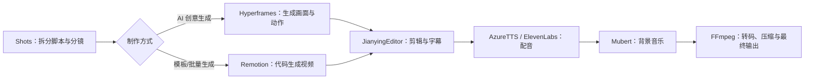

# Codex 视频制作必装的 8 个 Skill

> [!info] 来源说明
> 本笔记根据用户提供的截图整理。图中的热度数字是截图时的展示值，可能随时间变化；工具的实际可用性、授权方式和费用，使用前应另行确认。

## 一句话总结

这 8 个 Skill 覆盖了从**分镜策划、视频生成、程序化制作、剪辑处理，到配音和音乐**的主要环节，可以组成一条较完整的视频生产链路：

```text
分镜 → 生成/制作 → 剪辑与处理 → 配音 → 音乐 → 输出
```

## 8 个 Skill 总览

| Skill              | 定位      | 主要能力                     | 适用场景             |  截图热度 |
| ------------------ | ------- | ------------------------ | ---------------- | ----: |
| **Hyperframes**    | AI 视频生成 | 文生视频、图生视频、转场/动画控制        | 创意短视频、营销视频、AI 影片 | 9.8K+ |
| **Remotion**       | 代码生成视频  | 使用 React 语法生成视频，自动化渲染与导出 | 程序化视频、数据可视化、批量生成 | 6.5K+ |
| **JianyingEditor** | 剪映自动化   | 自动剪辑、批量处理、字幕与特效转换        | 短视频制作、自媒体批量剪辑    | 5.2K+ |
| **FFmpeg**         | 音视频处理   | 格式转换、剪辑合并、提取音频           | 视频压缩、格式转换、音频预处理  | 4.6K+ |
| **AzureTTS**       | 文本转语音   | 多语言、多音色、自然语音输出           | 视频配音、有声内容、多语言音频  | 3.8K+ |
| **ElevenLabs**     | AI 配音生成 | AI 配音、声音克隆、情绪表达          | AI 配音、角色配音、有声阅读  | 3.2K+ |
| **Shots**          | 镜头脚本生成  | 将脚本拆分为镜头、规划镜头语言          | 分镜设计、广告制作、故事板生成  | 2.9K+ |
| **Mubert**         | 版权音乐素材  | 按情绪/节奏生成音乐，提供可商用授权素材     | 背景音乐、短视频配乐、商业视频  | 2.6K+ |

## 按制作环节理解

### 1. 前期：把故事变成镜头

**Shots**负责把脚本拆成可执行的镜头，并规划景别、机位和镜头语言。它适合在正式生成视频前建立分镜骨架，减少“画面好看但叙事不清”的问题。

### 2. 生成与程序化制作

- **Hyperframes**：偏创意驱动的 AI 视频生成，适合快速探索画面、动作和转场效果。
- **Remotion**：偏代码和模板驱动的视频生产，适合数据驱动、批量化和可重复渲染的内容。

两者的区别可以简单理解为：Hyperframes 更适合“生成灵感和镜头”，Remotion 更适合“把规则和模板变成稳定的视频产线”。

### 3. 剪辑与底层音视频处理

- **JianyingEditor**：面向剪映工作流，适合自动剪辑、批量处理和短视频生产。
- **FFmpeg**：更底层、更通用，适合格式转换、合并、裁切、压缩和抽取音频等基础处理。

如果需要批量处理大量素材，通常可以让 FFmpeg 负责底层媒体处理，再让 JianyingEditor 负责更贴近成片的剪辑流程。

### 4. 配音与声音表达

- **AzureTTS**：适合多语言、多音色和稳定的文本转语音输出。
- **ElevenLabs**：更强调 AI 配音、声音克隆和情绪表达，适合角色化、表演化的声音。

选择时可以优先考虑：语言覆盖和批量稳定性选 AzureTTS，角色声音和情绪表现选 ElevenLabs。涉及声音克隆时，应确保拥有相应授权。

### 5. 音乐与版权素材

**Mubert**用于生成或选择背景音乐，重点是情绪、节奏和商业使用授权。配乐不只是“填满空白”，还应服务于镜头节奏、情绪转折和品牌气质。

## 推荐组合

| 目标 | 推荐组合 | 组合思路 |
| --- | --- | --- |
| 快速做一条 AI 创意短片 | Shots + Hyperframes + ElevenLabs + Mubert | 先分镜，再生成画面、角色配音和配乐 |
| 批量生产数据/模板视频 | Remotion + FFmpeg | 用代码生成画面，用 FFmpeg 完成媒体处理和输出 |
| 自媒体批量剪辑 | JianyingEditor + FFmpeg + AzureTTS | 自动整理素材、批量剪辑，并生成稳定的多语言配音 |
| 角色化故事视频 | Shots + Hyperframes + ElevenLabs | 强化镜头叙事、视觉生成和角色声音表现 |
| 商业视频交付 | Remotion/JianyingEditor + FFmpeg + Mubert | 兼顾模板化生产、格式输出和音乐授权 |

## 一条可执行的工作流



## 选择 Skill 的快速判断

- 想快速生成有创意的画面：先看 **Hyperframes**。
- 想把视频生产变成模板和程序：先看 **Remotion**。
- 想自动化剪映工作流：看 **JianyingEditor**。
- 想处理大量视频、音频或格式：看 **FFmpeg**。
- 想要稳定的多语言 TTS：看 **AzureTTS**。
- 想要角色声音、声音克隆和情绪：看 **ElevenLabs**。
- 想先把故事变成镜头表：看 **Shots**。
- 想找或生成可商用背景音乐：看 **Mubert**。

## 使用时的注意事项

- 截图中的“热度”只能作为线索，不能直接等同于工具质量或当前可用性。
- 生成式工具需要人工筛选和修正，尤其要检查人物一致性、动作连续性、空间关系和画面文字。
- 批量化工作流应统一素材命名、分辨率、帧率、音频采样率和输出格式。
- 配音、声音克隆、音乐和素材使用前，要确认肖像权、声音授权、版权和商业使用范围。
- 成片交付前应进行一次完整审片，重点检查节奏、字幕、音画同步、音量和平台规格。

## 相关笔记

- [[传统与AI影视动画制作流程]]
- [[镜头语言与叙事审美设计]]
- [[索引 - AIGC短剧视觉创作]]
