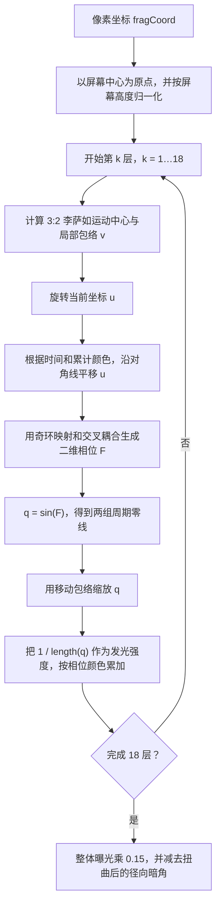

# ShaderToy 迭代域扭曲与倒距离发光代码解析

## 一句话结论

这段代码不是在绘制一个明确的几何物体，也没有使用纹理、噪声、光照或 Ray Marching。它是一台高度压缩的二维程序化图案生成器：对每个像素的坐标连续做 18 次旋转与平移，再用一个带奇环的非线性相位场生成两组正弦波，最后对波的共同零点做倒距离累加，从而产生高亮丝线、光斑、花瓣和等离子般的结构。

其视觉复杂度主要来自四个机制的叠加：

1. 逐层改变的坐标旋转与平移；
2. 半径为 $\sqrt{2}$ 的有理函数相位奇环；
3. 两组正弦波零线交点处的 $1/r$ 型发光；
4. 一个沿 3:2 [[李萨如曲线]]移动的局部亮度包络。

它属于 [[GLSL]] 中的迭代域变换（iterative domain warping）与加法式程序化发光，而不是物理意义上的光照计算。

## 原始代码

```glsl
// shaders lindos ♥ https://www.shadertoy.com/playlist/cXBGzV
#define rot(a) mat2(cos(a + vec4(0, 11, 33, 0)))

void mainImage(out vec4 o, vec2 u) {
    vec2 v, q, r = iResolution.xy;
    u = (u - r / 2.) / r.y;
    
    o = vec4(1, 2, 3, 0);
    
    float i, t = iTime;
    
    while(t++, i++ < 18.)
        v = cos(t * vec2(3, 2) + vec2(0, 11)) - 6. * u, 
        u *= rot(i - .1 * t),
        u += cos(4. / exp(dot(o, o) / 1e2) + t) / 5.,
        q = sin(
                u / (2. - dot(u, u)) 
                - 9. * u.yx 
                + t
            ), 
        q *= 1. + i * dot(v, v),
        o += (cos(vec4(1, 8, 4, 0) + t) + 1.) / length(q); 
    
    o *= .15;
    o -= dot(u, u) / 30.;
}
```

## 整体执行流程



这里最重要的是：它不是“先求出形状，再给形状上色”，而是每一层都同时改变坐标、生成波场并向颜色缓冲中加光。最终图像是 18 个不同相位、不同方向、不同局部中心的发光场叠加结果。

## 1. 坐标归一化

```glsl
vec2 v, q, r = iResolution.xy;
u = (u - r / 2.) / r.y;
```

在 `mainImage` 中，传入的 `u` 实际是当前像素坐标 `fragCoord`，单位为像素。设屏幕分辨率为

$$
\mathbf r=(W,H),
$$

则变换后

$$
\mathbf u_0=\frac{\text{fragCoord}-(W/2,H/2)}{H}.
$$

它完成两件事：

- 减去屏幕中心，使原点位于画面中心；
- 同时用高度 $H$ 缩放 x、y，保证图案不会因为宽高比不同而被拉伸。

因此 y 轴大致落在 $[-0.5,0.5]$，x 轴大致落在

$$
\left[-\frac{W}{2H},\frac{W}{2H}\right].
$$

与常见写法 `(2.0 * fragCoord - resolution) / resolution.y` 相比，这里的视觉尺度正好小一倍。

## 2. `rot(a)`：用魔法数字压缩出来的近似旋转矩阵

```glsl
#define rot(a) mat2(cos(a + vec4(0, 11, 33, 0)))
```

GLSL 的矩阵构造采用列主序。上式展开后，对应的数学矩阵是

$$
M(a)=
\begin{bmatrix}
\cos a & \cos(a+33)\\
\cos(a+11) & \cos a
\end{bmatrix}.
$$

魔法数字 `11` 和 `33` 是代码高尔夫技巧：

$$
11\bmod 2\pi\approx\frac{3\pi}{2}+0.00443,
$$

$$
33\bmod 2\pi\approx\frac{\pi}{2}+0.01328.
$$

于是

$$
\cos(a+11)\approx \sin a,
\qquad
\cos(a+33)\approx-\sin a,
$$

所以

$$
M(a)\approx
\begin{bmatrix}
\cos a&-\sin a\\
\sin a&\cos a
\end{bmatrix},
$$

也就是标准二维旋转矩阵。

但它并不完全正交，因此每次“旋转”还会带来很小的缩放和剪切。单次误差很小，连续迭代 18 次后却会成为图案有机感的一部分。

还有一个容易忽略的细节：

```glsl
u *= rot(a);
```

等价于 `u = u * rot(a)`，这里 `u` 位于矩阵左侧，被当作行向量相乘。因此在标准列向量语义下，它的旋转方向约等于 $-a$，与常见的 `rot(a) * u` 相反。

如果不追求极短代码，可写成更明确的版本：

```glsl
mat2 rot2(float a) {
    float c = cos(a);
    float s = sin(a);
    return mat2(c, s, -s, c);
}
```

## 3. `while` 与逗号运算符的真实执行顺序

```glsl
float i, t = iTime;

while(t++, i++ < 18.)
    expr1,
    expr2,
    expr3;
```

这里用了两个压缩技巧。

### 3.1 后缀自增发生在循环体之前

条件中的逗号运算符会先执行 `t++`，再计算 `i++ < 18.`。假设 `i` 从 0 开始，则循环体一共执行 18 次，并且第 $k$ 次循环体中：

$$
i=k,\qquad t=iTime+k,\qquad k=1,2,\ldots,18.
$$

也就是说，每一层都同时获得一个新的层编号和一个增加 1 弧度的时间相位。

在第 19 次条件检查时，`t++` 仍然会执行，然后条件才失败；不过之后不再使用 `t`，所以不影响图像。

### 3.2 没有花括号，但整个循环体仍是一个表达式语句

换行末尾的逗号不是语法装饰。所有赋值通过逗号运算符连接成一个表达式，并严格从左到右执行：

```text
计算 v
→ 旋转 u
→ 平移 u
→ 计算 q
→ 缩放 q
→ 累加 o
```

因此，`v` 使用旋转前的 `u`，而 `q` 使用旋转和平移后的 `u`。这是理解公式时非常重要的状态顺序。

### 3.3 原代码存在未初始化变量风险

`float i, t = iTime;` 只初始化了 `t`，没有初始化 `i`。GLSL 规范不保证局部变量自动为 0，因此严格来说这是未定义行为。它依赖具体驱动或编译器碰巧把 `i` 当作 0；在不同设备上可能不显示、循环次数异常，甚至直接出现不可预测结果。

可靠写法至少应为：

```glsl
float i = 0.0;
float t = iTime;
```

## 4. 把 18 层循环写成数学递推

设第 $k$ 层的时间相位为

$$
\tau_k=T+k,
$$

其中 $T=iTime$，$k=1,\ldots,18$。设进入本层时的坐标与累计颜色分别为 $\mathbf u_{k-1}$ 和 $\mathbf o_{k-1}$。

一层循环可概括为：

$$
\text{移动包络}
\rightarrow
\text{坐标旋转}
\rightarrow
\text{反馈平移}
\rightarrow
\text{非线性相位场}
\rightarrow
\text{倒距离发光累加}.
$$

下面逐项展开。

## 5. `v`：3:2 李萨如运动中心与亮度包络

```glsl
v = cos(t * vec2(3, 2) + vec2(0, 11)) - 6. * u;
```

分量形式为

$$
\mathbf v_k=
\begin{bmatrix}
\cos(3\tau_k)\\
\cos(2\tau_k+11)
\end{bmatrix}
-6\mathbf u_{k-1}.
$$

因为 $11\approx 3\pi/2\pmod{2\pi}$，所以

$$
\cos(2\tau+11)\approx\sin(2\tau).
$$

于是前面的二维点近似为

$$
\mathbf c(\tau)=
\begin{bmatrix}
\cos(3\tau)\\
\sin(2\tau)
\end{bmatrix},
$$

它会沿频率比为 3:2 的李萨如曲线运动。

更关键的是：

$$
\|\mathbf v_k\|^2
=\|\mathbf c_k-6\mathbf u_{k-1}\|^2
=36\left\|\mathbf u_{k-1}-\frac{\mathbf c_k}{6}\right\|^2.
$$

因此 `dot(v,v)` 本质上是像素到一个移动中心 $\mathbf c_k/6$ 的平方距离。这个中心的振幅只有 $1/6$，始终在画面中心附近沿 3:2 曲线运动。

随后：

```glsl
q *= 1. + i * dot(v, v);
```

会使最终发光强度除以

$$
E_k=1+36k\left\|\mathbf u_{k-1}-\frac{\mathbf c_k}{6}\right\|^2.
$$

所以 $E_k$ 是一个移动的局部亮度包络：靠近李萨如中心时几乎不衰减，远离时按平方距离变暗。随着层号 $k$ 增大，包络越来越窄；令衰减因子从 1 增加到 2 时，其特征半径约为

$$
r_k=\frac{1}{6\sqrt{k}}.
$$

这解释了为什么后期迭代产生的细节更集中、更尖锐。

## 6. 每层角度不同的累计旋转

```glsl
u *= rot(i - .1 * t);
```

第 $k$ 层送入矩阵的角度为

$$
a_k=k-0.1(T+k)=0.9k-0.1T.
$$

其作用包含两部分：

- `0.9k`：每一层使用不同方向，避免 18 层图案完全重合；
- `-0.1T`：所有层随时间缓慢旋转。

由于坐标在每层都会继续传给下一层，所以旋转是累计的。若暂时忽略中途平移与矩阵误差，18 层输入角度之和为

$$
\sum_{k=1}^{18}a_k
=0.9\frac{18\cdot19}{2}-1.8T
=153.9-1.8T.
$$

实际无法把它简单合并成一次旋转，因为每层旋转之间还穿插了平移，而且 `rot` 本身只是近似旋转。

## 7. 颜色反馈控制的对角线平移

```glsl
u += cos(4. / exp(dot(o, o) / 1e2) + t) / 5.;
```

标量加到 `vec2` 时会广播到两个分量，所以它等价于：

```glsl
float d = 0.2 * cos(4.0 * exp(-dot(o, o) / 100.0) + t);
u += vec2(d, d);
```

即坐标沿 $(1,1)$ 对角线平移。第 $k$ 层的平移量为

$$
\delta_k
=0.2\cos\left(
\tau_k+4e^{-\|\mathbf o_{k-1}\|^2/100}
\right).
$$

其中

$$
4e^{-\|\mathbf o\|^2/100}\in(0,4]
$$

是由已有累计颜色控制的相位偏移：

- 颜色能量较小时，相位反馈较强；
- 颜色累积变大后，指数项快速接近 0，平移逐渐退化为 $0.2\cos\tau_k$；
- `o` 是 `vec4`，所以 RGB 和 alpha 四个通道都会参与反馈。

初始时 $\mathbf o_0=(1,2,3,0)$，因此

$$
\|\mathbf o_0\|^2=14,
\qquad
4e^{-14/100}\approx3.48.
$$

也就是说，最初几层的坐标运动会明显受累计颜色影响；亮度升高后，这种反馈自动饱和。

## 8. `q`：奇环、交叉耦合与两组正弦零线

```glsl
q = sin(
        u / (2. - dot(u, u)) 
        - 9. * u.yx 
        + t
    );
```

设更新后的坐标为 $\mathbf u_k=(x,y)$，半径平方为

$$
\rho^2=x^2+y^2,
$$

则两维相位为

$$
F_x=\frac{x}{2-\rho^2}-9y+\tau_k,
$$

$$
F_y=\frac{y}{2-\rho^2}-9x+\tau_k,
$$

最后

$$
\mathbf q_k=
\begin{bmatrix}
\sin F_x\\
\sin F_y
\end{bmatrix}.
$$

### 8.1 半径 $\sqrt{2}$ 处的相位奇环

分母

$$
2-\rho^2
$$

在

$$
\rho=\sqrt{2}
$$

处为 0。接近该圆时，$\mathbf u/(2-\rho^2)$ 的数值急剧增大，使正弦相位在极小空间内高速振荡，于是出现极密的环纹、碎丝和干涉细节。

这个分母不会直接让亮度趋于无穷，因为外面还有有界的 `sin`；它制造的是“频率奇点”。真正的亮度奇点来自后面的 `1 / length(q)`。在分母恰为 0 时还可能产生 `Inf/NaN`，原代码没有做数值保护。

由于 `u` 在每层都被旋转和平移，从原始屏幕坐标观察，这个半径 $\sqrt{2}$ 的圆也会被反复移动和轻微扭曲，最终不再表现为一个简单的圆环。

### 8.2 `u.yx` 产生交叉耦合

`u.yx` 会交换 x、y：

$$
(x,y)\longrightarrow(y,x).
$$

因此 x 相位强烈依赖 y，y 相位强烈依赖 x。系数 `9` 决定基础条纹密度：数值越大，单位空间内的相位变化越快，线条越密。

若使用对角基底

$$
\mathbf e_+=\frac{1}{\sqrt2}(1,1),
\qquad
\mathbf e_-=\frac{1}{\sqrt2}(1,-1),
$$

交换矩阵在这两个方向上的特征值分别为 $+1$ 和 $-1$。因此线性相位部分在两个对角方向上的局部倍率是

$$
\lambda_+=\frac{1}{2-\rho^2}-9,
$$

$$
\lambda_-=\frac{1}{2-\rho^2}+9.
$$

这说明两个对角方向被不同程度地拉伸，并且在奇环两侧还会改变方向。代码中的标量 `+t` 同时加到 x、y，只直接推动 $(1,1)$ 方向的相位，因此动画天然带有对角运动偏向。

### 8.3 正弦零线

`sin(Fx)` 的零点满足

$$
F_x=m\pi,
$$

`sin(Fy)` 的零点满足

$$
F_y=n\pi,
$$

其中 $m,n$ 为整数。每个方程都会在屏幕上形成一族曲线；两族曲线同时接近零的位置就是潜在高亮点与高亮丝线。

## 9. `1 / length(q)`：真正的发光核心

```glsl
q *= 1. + i * dot(v, v);

o += (cos(vec4(1, 8, 4, 0) + t) + 1.) / length(q);
```

缩放后的长度为

$$
\|\mathbf q_k\|
=E_k\sqrt{\sin^2F_x+\sin^2F_y},
$$

因此第 $k$ 层、颜色通道 $c$ 的增量为

$$
\Delta o_{k,c}
=
\frac{1+\cos(\tau_k+\phi_c)}
{E_k\sqrt{\sin^2F_x+\sin^2F_y}},
$$

其中

$$
\boldsymbol\phi=(1,8,4,0)
$$

分别对应 R、G、B、A 四个通道。

当 $F_x$ 与 $F_y$ 同时接近某个 $\pi$ 的整数倍时，令小偏差为 $\varepsilon_x,\varepsilon_y$，利用

$$
\sin(n\pi+\varepsilon)\approx(-1)^n\varepsilon,
$$

可得

$$
\sqrt{\sin^2F_x+\sin^2F_y}
\approx
\sqrt{\varepsilon_x^2+\varepsilon_y^2}.
$$

于是亮度局部近似

$$
I\propto\frac{1}{\sqrt{\varepsilon_x^2+\varepsilon_y^2}},
$$

也就是相位空间中的 $1/r$ 型倒距离光晕。这就是线条看起来“自己发光”的根本原因，并非使用了 Bloom 或真实光照。

原代码没有给分母加 epsilon。当 `length(q)` 真正等于 0 时，颜色会趋于无穷；实际显示时通常被帧缓冲裁剪为极亮像素，也可能在某些 GPU 上产生 `Inf/NaN`。

## 10. 四通道相位颜色与加法混合

```glsl
cos(vec4(1, 8, 4, 0) + t) + 1.
```

每个通道都是范围 $[0,2]$ 的余弦振荡：

$$
C_c(\tau)=1+\cos(\tau+\phi_c).
$$

四个通道相位不同，所以它们会轮流增强或减弱。这里没有使用经典的 `2π * palette()` 形式，而是直接把时间和层号视作弧度；相邻迭代层正好相差 1 弧度，因此每层都获得不同色相倾向。

所有层都使用 `o += ...` 相加，没有互相覆盖，也没有负贡献。这是典型的加法式 HDR 累积：层数越多，交叉区域越亮，类似多个发光体叠加。

初始颜色

```glsl
o = vec4(1, 2, 3, 0);
```

还提供了一个偏蓝的底色，并让第一轮颜色反馈不从零开始。

## 11. 最后的曝光与暗角

```glsl
o *= .15;
o -= dot(u, u) / 30.;
```

第一句把 18 层的累计能量统一乘以 0.15，相当于手动曝光控制。

第二句从 RGBA 四个通道同时减去

$$
\frac{\|\mathbf u_{18}\|^2}{30},
$$

形成径向暗化。但这里使用的不是原始屏幕坐标，而是经历 18 次旋转和平移后的最终 `u`，所以严格说它是“跟随扭曲坐标的暗角”，可能偏心并随时间变化。

负颜色通常会在最终显示时被裁剪到 0。代码也没有显式 Tone Mapping 或 Gamma 校正，因此高亮部分主要依赖输出缓冲的裁剪产生强烈对比。

ShaderToy 通常不关心 alpha 如何显示，但这里 alpha 同样被累积、参与反馈、缩放和暗角。如果把代码移植到使用透明混合的项目中，必须重新定义 alpha，否则混合结果可能异常。

## 12. 完整的单层数学公式

把上面的步骤合并起来，第 $k$ 层可写为：

$$
\tau_k=T+k,
\qquad
\mathbf c_k=
\begin{bmatrix}
\cos(3\tau_k)\\
\cos(2\tau_k+11)
\end{bmatrix},
$$

$$
\mathbf v_k=\mathbf c_k-6\mathbf u_{k-1},
$$

$$
\tilde{\mathbf u}_k
=\mathbf u_{k-1}M(0.9k-0.1T),
$$

$$
\delta_k
=0.2\cos\left(
\tau_k+4e^{-\|\mathbf o_{k-1}\|^2/100}
\right),
$$

$$
\mathbf u_k
=\tilde{\mathbf u}_k+\delta_k(1,1),
$$

$$
\mathbf F_k
=\frac{\mathbf u_k}{2-\|\mathbf u_k\|^2}
-9S\mathbf u_k
+\tau_k(1,1),
\qquad
S=
\begin{bmatrix}
0&1\\1&0
\end{bmatrix},
$$

$$
E_k=1+k\|\mathbf v_k\|^2,
$$

$$
\mathbf o_k
=\mathbf o_{k-1}
+\frac{1+\cos(\boldsymbol\phi+\tau_k)}
{E_k\|\sin(\mathbf F_k)\|},
\qquad
\boldsymbol\phi=(1,8,4,0).
$$

最终输出：

$$
\mathbf o_{out}
=0.15\mathbf o_{18}
-\frac{\|\mathbf u_{18}\|^2}{30}(1,1,1,1).
$$

这组递推式揭示了它的核心：颜色不是一个只依赖最终坐标的函数，而是与坐标共同演化的状态变量。`o` 影响下一步平移，下一步坐标又影响新的 `o`，因此它是一个弱耦合的离散动力系统。

## 13. 参数如何控制视觉

| 参数 | 数学作用 | 增大后的视觉变化 |
| --- | --- | --- |
| `18` | 迭代层数 | 结构更复杂、更亮；成本线性增加 |
| `3, 2` | 李萨如中心的频率比 | 改变运动轨迹的瓣数与闭合周期 |
| `6` | 把像素坐标映射到移动中心距离 | 包络更窄，亮区更集中于中心轨迹 |
| `i` in `1 + i*dot(v,v)` | 随层号增强局部化 | 后期层更尖锐、更局部 |
| `0.1` | 时间对旋转角的影响 | 增大后旋转动画更快 |
| `/5` | 对角平移振幅，即 0.2 | 增大分母会减弱流动和层间错位 |
| `100` | 颜色反馈衰减尺度 | 增大后颜色反馈维持得更久 |
| `2` | 有理相位奇环的半径平方 | 奇环半径变为该值的平方根 |
| `9` | x/y 交叉相位频率 | 线条更密、交叉更多，也更易走样 |
| `(1,8,4,0)` | RGBA 相位偏移 | 改变整体配色和通道轮换顺序 |
| `0.15` | 全局曝光 | 整体变亮 |
| `30` | 最终暗角强度的分母 | 增大后暗角减弱 |

## 14. 可读且更稳定的改写

下面的版本保留原效果的主要结构，同时修复 `i` 未初始化与除零问题，并把隐式标量广播、逗号表达式和反馈项拆开。`max(..., 1e-4)` 会限制极端峰值，所以它与原代码不是逐位等价，而是工程上更稳定的版本。

```glsl
mat2 rotGolf(float a) {
    // 保留原作的近似旋转以及轻微剪切感
    return mat2(cos(a + vec4(0.0, 11.0, 33.0, 0.0)));
}

void mainImage(out vec4 fragColor, in vec2 fragCoord) {
    vec2 resolution = iResolution.xy;
    vec2 p = (fragCoord - 0.5 * resolution) / resolution.y;

    vec4 accum = vec4(1.0, 2.0, 3.0, 0.0);

    for (int layer = 1; layer <= 18; ++layer) {
        float k = float(layer);
        float timePhase = iTime + k;

        // 使用旋转前的 p 计算移动的李萨如亮度包络
        vec2 centerPhase = cos(
            timePhase * vec2(3.0, 2.0) + vec2(0.0, 11.0)
        );
        vec2 v = centerPhase - 6.0 * p;

        // 原作使用行向量右乘矩阵
        p = p * rotGolf(k - 0.1 * timePhase);

        // 累计颜色只控制平移的相位，不直接改变平移振幅
        float feedbackPhase = 4.0 * exp(-dot(accum, accum) / 100.0);
        float diagonalShift = 0.2 * cos(feedbackPhase + timePhase);
        p += vec2(diagonalShift);

        // 带 sqrt(2) 奇环的二维相位场
        float radialDenom = 2.0 - dot(p, p);
        vec2 phase = p / radialDenom - 9.0 * p.yx + timePhase;
        vec2 wave = sin(phase);

        // 李萨如中心附近亮、远处暗；后期层的包络更窄
        float envelope = 1.0 + k * dot(v, v);
        float distanceToWaveCrossing = max(
            envelope * length(wave),
            1e-4
        );

        vec4 layerColor = cos(
            vec4(1.0, 8.0, 4.0, 0.0) + timePhase
        ) + 1.0;

        accum += layerColor / distanceToWaveCrossing;
    }

    accum *= 0.15;
    accum -= dot(p, p) / 30.0;

    fragColor = accum;
}
```

如果希望得到严格的纯旋转，可把 `rotGolf` 替换为标准旋转矩阵；视觉会更规整，但会失去原作由近似误差带来的一点自然形变。

## 15. 常见误读与数值风险

### 它不是分形公式

它确实使用了迭代和反馈，因此有分形式的复杂度增长，但没有典型的逃逸时间判断、自相似尺度递归或复二次映射。更准确的归类是“迭代坐标扭曲 + 周期场奇点累加”。

### `u / (2 - dot(u,u))` 不是 SDF

它没有返回到某个表面的有符号距离，而是在扭曲正弦波的输入相位。因此不能用 SDF 的距离安全步进逻辑解释。

### 发光不是 Bloom

画面发亮来自倒距离函数产生的大数值以及加法累积。它没有采样邻近像素，也没有做模糊，所以不是后处理 Bloom。若再接 Bloom，会得到更柔和、更扩散的光晕。

### 高频区域会走样

接近 $\rho=\sqrt2$ 时相位频率趋于无穷，单个像素无法正确采样所有振荡，会出现闪烁、摩尔纹和分辨率依赖。可使用 `fwidth` 做解析抗锯齿，或限制 `radialDenom` 的最小绝对值。

### 除零与 `NaN`

有两处危险：

- `2.0 - dot(u,u) == 0.0`；
- `length(q) == 0.0`。

代码高尔夫作品通常接受这些风险以换取字符数和强烈高光；产品代码应加入有符号 epsilon、峰值限制和 Tone Mapping。

## 16. 从视觉结果反推每个机制

| 看到的视觉现象 | 主要来源 |
| --- | --- |
| 中心附近游动的亮区 | 3:2 李萨如移动包络 `dot(v,v)` |
| 密集、弯曲的丝线 | `sin(phase)` 的零线和迭代坐标变换 |
| 极亮交点 | `1 / length(q)` 的倒距离奇点 |
| 环状或爆裂状高频纹理 | `u / (2-dot(u,u))` 的 $\sqrt2$ 相位奇环 |
| 对角线方向的拉扯与流动 | `-9*u.yx` 和标量平移同时作用于 x、y |
| 多彩霓虹感 | RGBA 不同相位的余弦颜色 + 18 层加法累积 |
| 有机而不完全对称 | 魔法数字近似旋转带来的轻微缩放/剪切 |
| 边缘变暗 | 最后的 `dot(u,u)/30` |

## 最终理解

这段代码的高明之处不在于使用了某个复杂算法，而在于让每个短表达式同时承担多个职责：

- `cos(t*vec2(3,2)+...)` 同时负责动画和空间包络中心；
- 魔法数字旋转矩阵同时提供旋转与细微形变；
- `u/(2-dot(u,u))` 同时提供径向结构和无限增密的相位；
- `u.yx` 用一次 swizzle 建立双轴耦合；
- `1/length(q)` 把周期波场直接转换成发光结构；
- 四通道余弦通过相位差完成动态配色；
- 累计颜色又反过来影响下一轮坐标。

因此，十几行代码实际上定义了一个随时间演化、坐标与颜色弱耦合的二维离散动力系统。画面并不是被“画”出来的，而是从反复变换的相位场与奇点中涌现出来的。

## 相关概念

- [[ShaderToy]]
- [[GLSL]]
- [[Domain Warping]]
- [[李萨如曲线]]
- [[程序化纹理]]
- [[倒距离场]]
- [[加法混合]]
- [[数值稳定性]]

