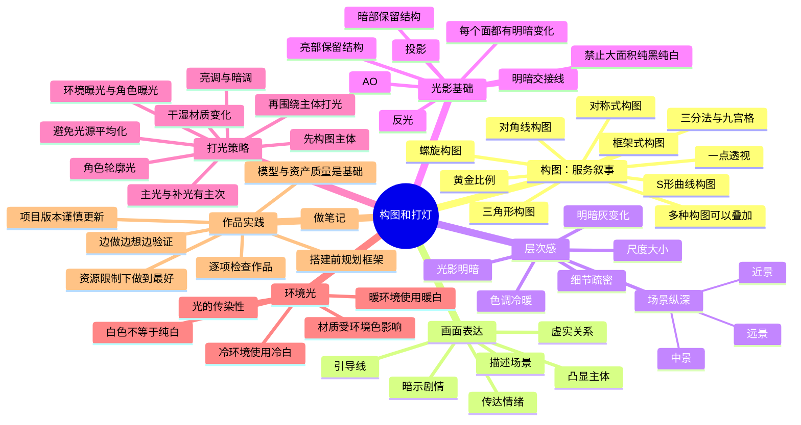

# 技术美术课程：构图和打灯

> 来源：[技术美术课程构图和打灯.mp4](F:/MyBrain/MyLearning/技术美术课程构图和打灯.mp4)｜时长：37:39｜Watch Skill 视频 ID：`3336a7abd5835609`

这是一节面向技术美术、地编和特效同学的构图与灯光课。课程反复强调：**构图负责讲故事，灯光负责突出主体、建立层次和塑造真实感**。

说明：截图来自视频关键帧；时间为视频绝对时间。语音由本地 Whisper 转录，个别专有名词可能存在误听，正文以画面导图和上下文进行了校正。

## 时间线与对应截图

### 00:00–03:08｜课程导入：构图首先服务于叙事

课程把影视、3A 游戏、游戏和高质量动画作为参考对象。老师的判断标准是：画面不只是好看，还要让观众感到“这里发生了什么”。

### 03:08–05:37｜三分法、九宫格、黄金比例、对称与一点透视

三分线/九宫格把主体或视觉重点放在关键交点附近；黄金比例与三分之一位置接近。对称式构图稳定但容易呆板；一点透视适合让观众第一眼锁定主体。

### 05:38–08:58｜框架、三角形与对角线构图

框架式构图通过前景、中景、远景安排一、二、三层空间；三角形带来压迫感和力量感，适当倾斜比规整的正三角更有聚焦和引导性；对角线强化动势和故事性。多种构图可以叠加在同一张图里。

### 09:00–11:10｜螺旋、黄金比例与 S 形曲线

螺旋/黄金比例用于把视线逐步引向主体；道路、河流等线性元素适合做成 S 形，避免直线把视线“挡住”。

### 11:18–14:44｜画面表达：场景、剧情、情绪、主体与引导线

老师把画面表达拆成几个互相配合的功能：描述场景、暗示剧情、传达情绪、凸显主体和引导视线。主体可以是角色、建筑或物件，但不能让多个相似物体争夺同一视觉中心。

### 14:45–20:40｜层次感：明暗、纵深、尺度、细节与冷暖

课程给出的层次感维度包括：

- 光影明暗：暗部和亮部都要有结构。
- 场景纵深：近景、中景、远景共同建立空间。
- 尺度大小：比例变化会改变视觉冲击力。
- 细节疏密：用局部遮挡、物件和体积控制信息密度。
- 色调冷暖：冷暖对比是吸引注意力的重要手段。

### 20:49–24:10｜基础光影：明暗交接线、反光、投影与 AO

课程用球体示意光影结构，要求掌握明暗交接线、反光、投影和 AO。最深的区域通常出现在 AO 和明暗交接附近，但画面不能大面积死黑；亮调和暗调作品都必须保留细节。

### 24:11–27:29｜打光策略：先主体，后灯光；角色要有轮廓光

打光分为给环境打光和给角色打光。建议先确定构图主体，再围绕主体布置光源；主体附近最亮，其他区域逐级减弱，不能让所有光源平均化。角色通常需要轮廓光，以便与背景分离；场景则不一定必须有轮廓光。

### 27:30–33:40｜真实光源、主次关系、过曝/死黑与材质变化

真实光照不会让整面墙保持同一个值；同一材质内部也应有从亮到灰再到暗的变化。要避免过曝导致没有结构，也要避免暗部完全没有信息。3A 游戏还要表现干湿变化，并使用适量补光来服务主体和叙事。

### 33:43–37:36｜光的传染性、实践方法与项目约束

环境光会影响周围材质：暖环境中的白色会偏暖，冷环境中的白色会偏冷，因此不要把白色处理成脱离环境的纯白。最后的建议是做笔记、逐项检查作品、在搭建前规划框架，并在资源和引擎限制下把画面做到最好。

## 课程核心内容

### 构图检查

1. 画面是否有明确主体？
2. 主体是否处在有意义的三分线、黄金比例、框架或引导线上？
3. 前景、中景、远景是否形成纵深？
4. 构图是否暗示了剧情或情绪？
5. 是否存在多个相似主体争夺注意力？
6. 是否过于对称、规整，导致画面呆板？

### 灯光检查

1. 是否先确定主体，再围绕主体打光？
2. 主光、补光和环境光是否有主次？
3. 角色是否通过轮廓光与背景分离？
4. 暗部、亮部和每个材质面是否保留结构与明暗灰变化？
5. 是否出现大面积死黑、过曝或纯色？
6. 是否有冷暖关系、环境色传递和干湿材质变化？

### 作品制作检查

- 在搭建前先规划构图框架，边做边检查，而不是最后才补救。
- 不要只靠灯光掩盖低质量模型或资产；底子不好，构图和灯光也救不了画面。
- 影视动画可以更激进地堆灯，游戏场景要同时考虑性能、玩法和资源预算。
- 项目进行中谨慎更新引擎或打包流程，避免版本变化破坏整个项目。

## 导图复刻

原始导图截图：

下面是根据原始导图、板书截图和完整语音转录复刻的可编辑版：

可单独编辑的源文件：[技术美术课程构图和打灯_导图复刻.mmd](技术美术课程构图和打灯_导图复刻.mmd)

## 一页式结论

> **先用构图决定“观众看什么、为什么看”；再用层次决定“前后关系和空间感”；最后用灯光决定“主体如何从环境中被看见”。**

## 相关知识

- [[4种神级构图法]]
- [[光影]]
- [[镜头语言与叙事审美设计]]
- [[颜色的运用]]
